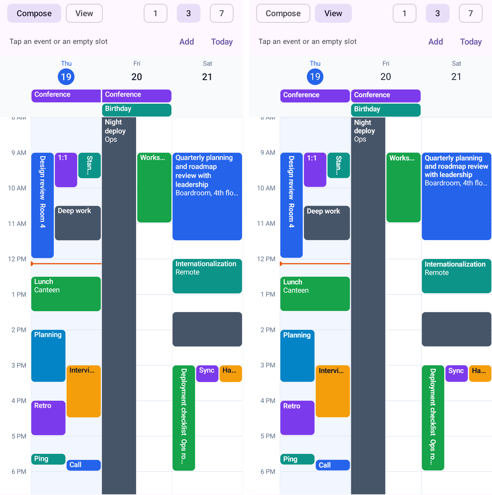
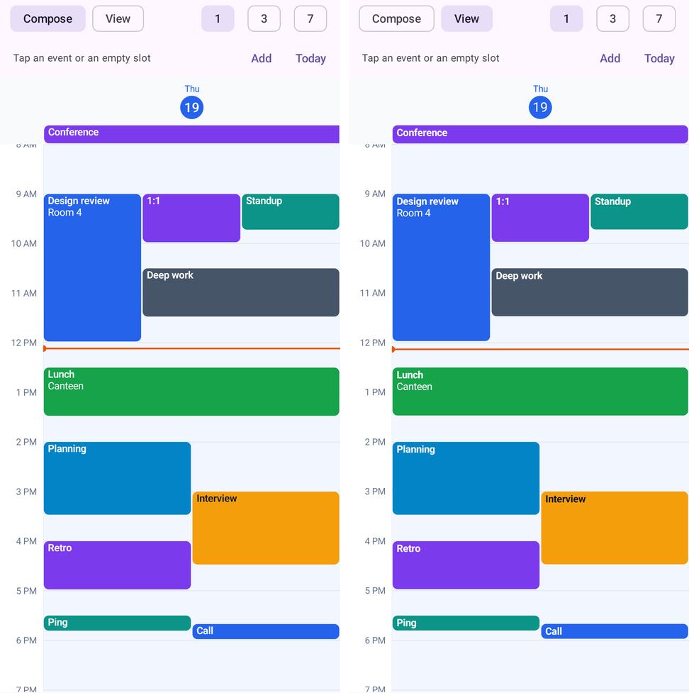
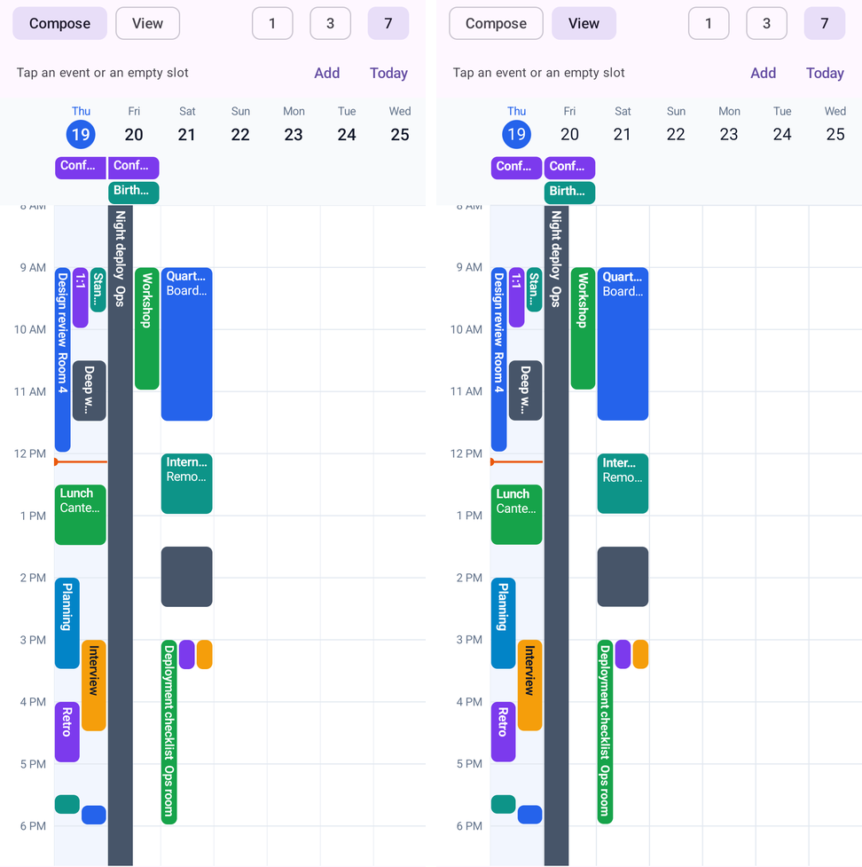
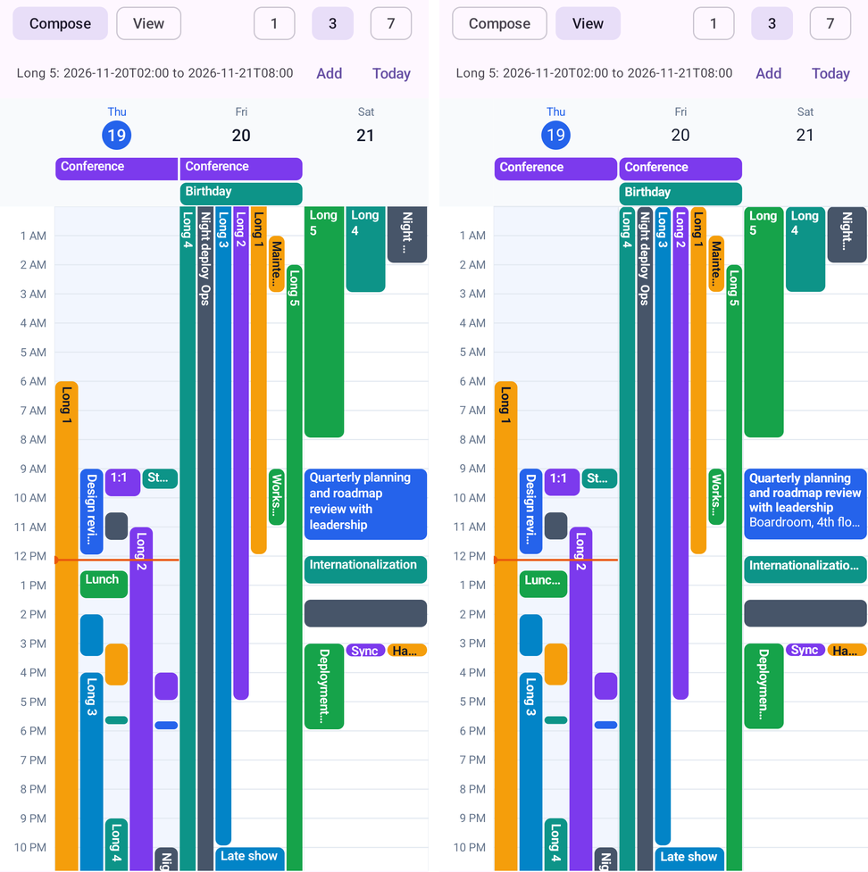
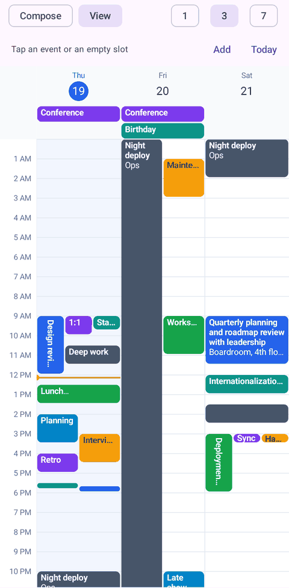
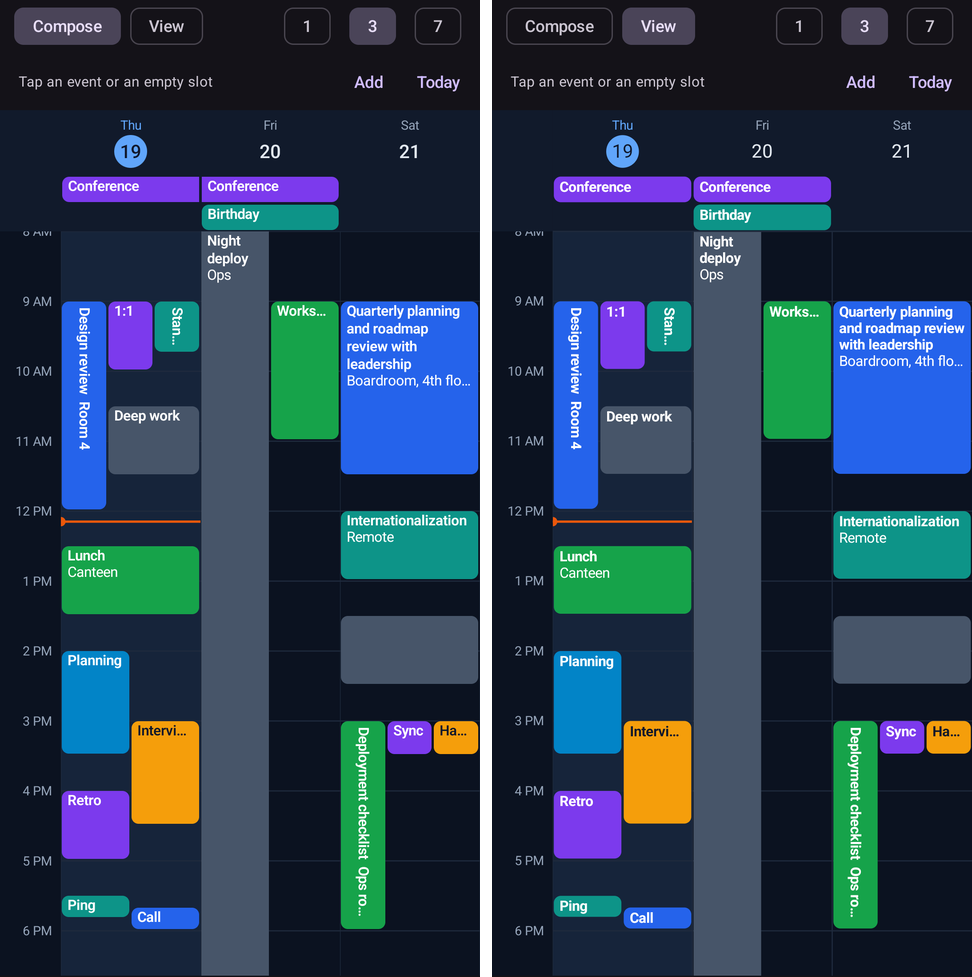
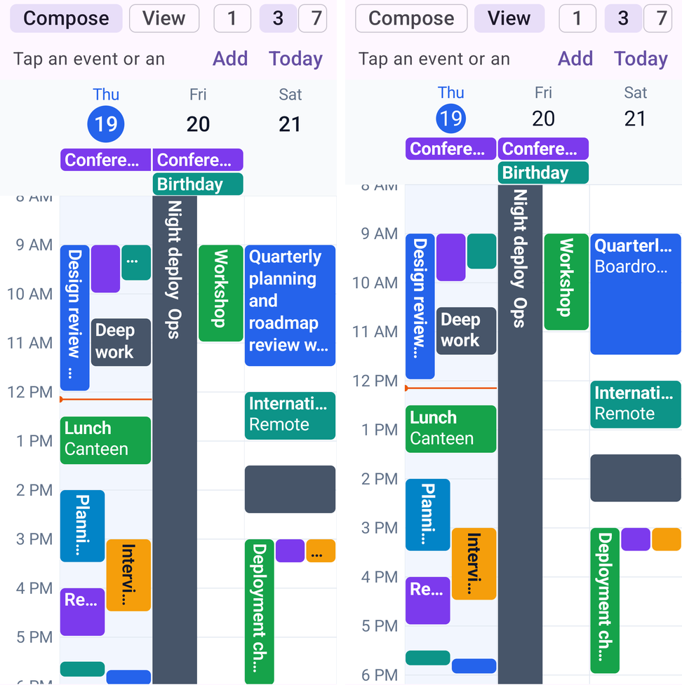
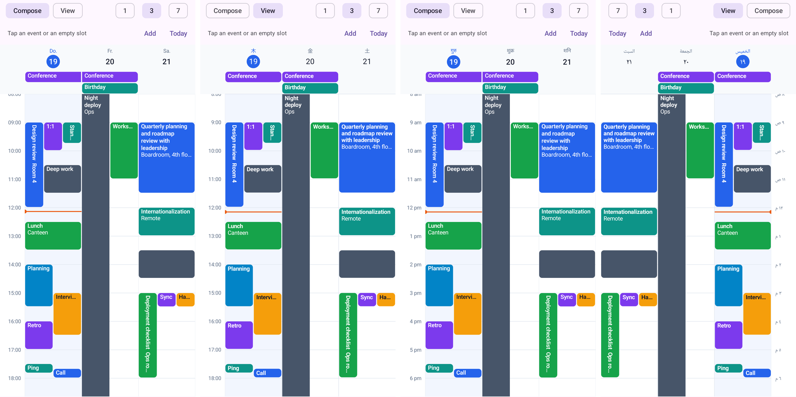

# WeekView KMP

A day, multi-day and week calendar grid for Android Views and Compose Multiplatform. Both renderers
draw from one shared layout engine, so overlapping events are placed side by side and never on top
of each other.



In every picture the Compose `WeekView` is on the left and the Android `View` on the right.

| Day | Week |
|---|---|
|  |  |

| Events that cross midnight | Added one at a time |
|---|---|
|  |  |

| Dark | Font scale 1.8 |
|---|---|
|  |  |

German, Japanese, Hindi and Arabic (right to left):



## Modules

| Artifact | What it is | Targets |
|---|---|---|
| `io.github.androidpoet:weekview` | `WeekViewLayout` (the layout engine) and `WeekView`, an Android `View` | Android, JVM, iOS, wasmJs (the `View` is Android only) |
| `io.github.androidpoet:weekview-compose` | `WeekView` composable | Android, JVM desktop, iOS, wasmJs |

```kotlin
dependencies {
    implementation("io.github.androidpoet:weekview:0.1.0")          // Views
    implementation("io.github.androidpoet:weekview-compose:0.1.0")  // Compose
}
```

## Events

Events use wall-clock `kotlinx.datetime.LocalDateTime`. The end is exclusive, and colors are ARGB.

```kotlin
val events = listOf(
    WeekViewEvent(
        id = "standup",
        title = "Standup",
        start = LocalDateTime(2026, 3, 2, 9, 0),
        end = LocalDateTime(2026, 3, 2, 9, 30),
        color = 0xFF0D9488.toInt(),
        location = "Room 4",
    ),
    WeekViewEvent(
        id = "conference",
        title = "Conference",
        start = LocalDateTime(2026, 3, 2, 0, 0),
        end = LocalDateTime(2026, 3, 4, 0, 0),
        isAllDay = true,
    ),
)
```

## Compose

```kotlin
val state = rememberWeekViewState()

WeekView(
    events = events,
    state = state,
    visibleDays = 3,
    onEventClick = { event -> },
    onEmptyClick = { dateTime -> },
    modifier = Modifier.fillMaxSize(),
)
```

`state.animateScrollToDate(date)`, `state.scrollToHour(8.5f)` and `state.firstVisibleDate` move and
observe the grid. Pass `style = WeekViewDefaults.style().copy(...)` to change colors and sizes, and
`eventContent`, `dayHeader` or `timeLabel` to draw your own content.

## Android View

```xml
<io.github.androidpoet.weekview.WeekView
    android:id="@+id/weekView"
    android:layout_width="match_parent"
    android:layout_height="match_parent"
    app:visibleDays="3" />
```

```kotlin
weekView.events = events
weekView.onEventClick = { event -> }
weekView.onEmptyClick = { dateTime -> }
weekView.goToToday()
```

## Language, clock and time zone

- Hour labels follow the device: `9 AM` where a 12-hour clock is used, `09:00` where a 24-hour
  clock is. On Android the user's 24-hour setting wins over the locale.
- Weekday names and day numbers use the device's language and digits.
- The hour column widens to fit the longest label, and headers and all-day rows grow with the
  font scale.
- A right-to-left layout puts the hour column on the right and runs the days right to left.
- "Now" and "today" come from the device's clock and time zone. When your events are in another
  zone, pass your own time: `now = ...` in Compose, `weekView.currentTime = { ... }` on the View.
- Pass `timeLabel` (Compose) or set `weekView.timeLabel` / `weekView.weekdayLabel` (View) for your
  own labels. `localizedHourLabel`, `localizedWeekdayLabel` and `localizedDayOfMonth` are public.

## Behaviour

- Days scroll horizontally without end and snap to a column; hours scroll vertically; pinch changes the hour height.
- Events that overlap in time get separate columns. Each event is sized by how crowded its own part of the day is.
- A timed event that crosses midnight continues in the next day's column. An event ending at 00:00 belongs to the previous day.
- All-day events sit in a row above the grid; a multi-day one keeps the same row on every date. At most
  `maxAllDayRows` rows (3 by default) are shown; a date with more shows a "+N" marker in the last row.
- Positions have minute precision: a start is rounded down and an end up.
- Event text wraps at spaces, falls back to one ellipsized line, or runs down a narrow tall block. It never breaks inside a word.

## Layout engine only

`WeekViewLayout` has no UI dependency and can drive your own renderer:

```kotlin
val layout = WeekViewLayout.of(events)
layout.timedSlots(date).forEach { slot ->
    // slot.startMinute, slot.endMinute, slot.left and slot.width (fractions of the day width)
}
```

## License

MIT. See [LICENSE](LICENSE).
